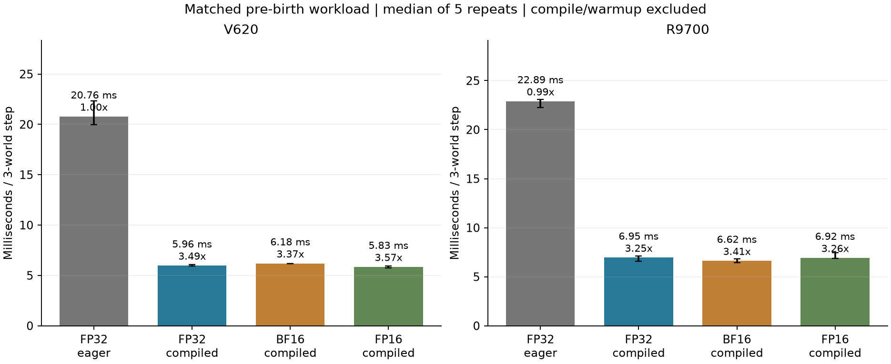
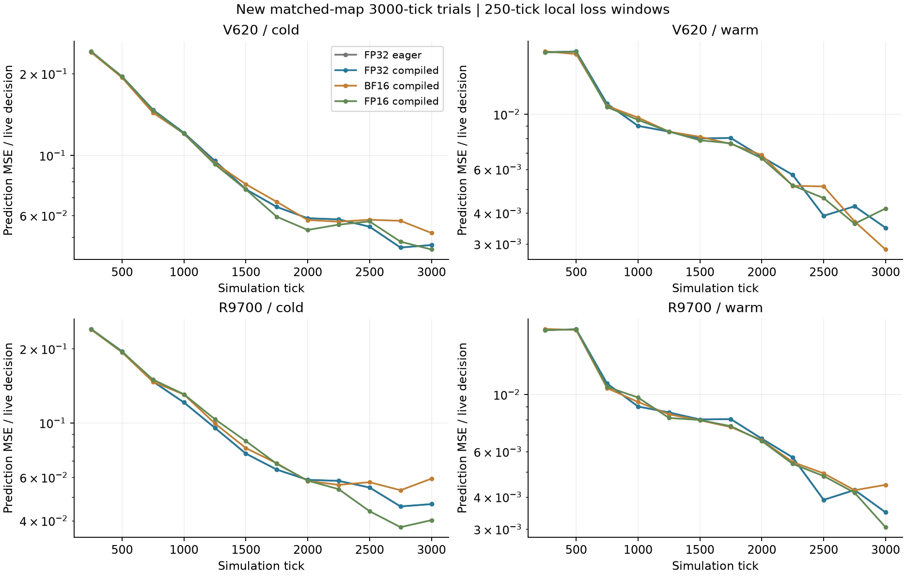

# GPU最適化と混合精度の実装・検証

2026年10月11日（日本時間）。前回の採食・予測誤差の変化を参照し、世界・内的評価・学習率・モデルサイズを維持してGPU処理を最適化した。停止済みのセッション反復は再開せず、別名の検証試行を作成した。低精度の長い確率的な軌跡の完全一致は合格条件にしていない。

**FP32の演算融合で約3.2〜3.5倍の定常速度を確認。FP16・BF16でも学習の傾向を維持したが、低精度化単独の追加利益は小さい。現在の基準としては最適化FP32が扱いやすい。**

## 実装

- `precision: fp32 / bf16 / fp16`、`execution: eager / kernels / compiled`を設定・CLIへ追加。既定値は従来のFP32/eager。
- `kernels`は感覚コア・行動サンプリング・予測損失・個体別Adam・内的評価・actor/critic更新をcompileする。`compiled`はさらに世界の状態更新・観測生成をcompileする。
- 混合精度はエンコーダ・GRU投影・特徴・予測の行列演算へ適用し、結果はFP32へ戻す。基準重み・遺伝基底・hidden・LayerNorm・統計・trace・更新上限・行動/価値ヘッド・物理はFP32のまま。
- FP16の予測勾配は既定128倍でloss scalingし、個体ごとに有限性を確認してから元へ戻し、clip・Adam更新する。一個体のoverflowで他個体を停止する仕組みは使わない。
- 遺伝・出生時リセット・個体の独立性・相対操作・方角入力・内的評価の内容・代謝・繁殖費は変更しない。新しい報酬・経験再処理・時間尺度変更は入れていない。
- 旧checkpointも読み込める。precision/backendの変更は新しい出力先とmetadataに記録する。

## 定常処理の速度

96×32、3世界、初期32体/世界、容量128、hidden64、一個体65,625パラメータ。前回のCPU初期個体バンクを読み込み、32tickのウォームアップ後に160tickを5回計測した。出生開始前の共通の負荷で、全条件96体が生存。各GPUは独立プロセス、CPU affinityを固定。profilerは計測とは別に実行した。

下表は**3世界を1tick進める処理時間**の中央値。コンパイル・ウォームアップ・表示/保存の時間は含めない。倍率は変更前の凍結した実装に対するもの。

| GPU | 変更前FP32 | 最適化FP32 | 最適化BF16 | 最適化FP16 |
| --- | ---: | ---: | ---: | ---: |
| V620 | 20.84ms | 5.96ms（3.49倍） | 6.18ms（3.37倍） | 5.83ms（3.57倍） |
| R9700 | 22.56ms | 6.95ms（3.25倍） | 6.62ms（3.41倍） | 6.92ms（3.26倍） |

GPU間の序列の解釈には注意が必要。上の測定ではCPUの固定先が異なっていた。[追加診断](../2026-10-11-gpu-dispatch/results.md)では、同じCPU配置でもR9700のFP32は約5.91〜6.55msとプロセス間で変動した一方、GPUカーネルの実行時間はV620より短かった。処理投入・同期等の待ちが全体速度へ強く影響しており、この表からGPU演算性能の優劣は決めない。

学習部分だけの融合は約1.8倍で、世界と観測も融合すると上表の速度になった。1tickのGPUカーネル起動は変更前1,581回からFP32最適化187回へ減少。BF16は197回、FP16は206回だった。

V620では低精度だけを有効にした通常実行は、BF16約21.95ms、FP16約24.00msで、変更前約20.84msより速くならなかった。最適化後でもBF16はFP32より少し遅く、FP16の改善は約2%。R9700のBF16はFP32最適化に対し約5%、FP16はほぼ同程度。低精度の追加効果は小さく、後の1回だけの確認ではFP16がFP32より遅い値も出ているため、追加利益の安定した倍率は主張しない。



### 初回費用と実際の短試行

コンパイルの初回費用は別にある。初期のR9700確認では学習部分の初回遷移に約63秒、その後に世界部分を追加した初回確認に約37秒かかった。キャッシュがある後続測定では、最適化候補の初回遷移は約16〜53秒だった。これらは異なるキャッシュ状態で、完全なcold-start時間の統計ではない。モデル形状を頻繁に変える数十tickの試行では初回費用が利益を上回りうる。

表示・系譜・リプレイ・保存とコンパイルを含む3,000tickの検証では、例として獲得モデルのFP32通常実行はV620約66秒、R9700約71秒、最適化版は約20〜23秒だった。最適化した未学習モデルの最初の試行は約40〜49秒となり、初回処理の影響が表れた。これは各条件一回の記述値で、定常の5回計測と分けて扱う。

## 数値と学習の確認

同じ観測・操作・予測対象で勾配cosine≥0.98、勾配相対L2≤20%、予測損失の相対差≤5%、有限なFP32の重み更新があることを事前の基準にした。全ての最適化候補が通過。BF16の勾配cosineは約0.99964、相対L2差約2.67%、損失差約0.013%。FP16はcosine約0.9999995、相対L2差約0.10%、損失差0.001%未満だった。Adamの一更新の相対L2差はBF16約10%、FP16約2.3%であり、微小な勾配の符号等の違いも含む。これを長期の軌跡の一致とは解釈しない。

前回の第9セッション用の初期保存から、同じ物理的初期状態の未学習モデル（cold）と獲得モデル（warm）を使った。GPU2種類×方式4種類×初期モデル2種類、各3世界・3,000tick、合計16試行。世界seedは8000066と世界間の従来差1009。各方式は対応する同じCPU保存を読み込み、追加の人間データ・外的課題報酬は使わない。

予測誤差は250tick区間ごとに、生存個体の実判断数から求めた。累積平均をそのまま後半の誤差として使わず、出生・死亡ログから判断数を復元して区間の差を計算した。表の最初500/最後750tickは、該当する250tick区間の誤差の単純平均。cold/warmは遺伝基底と観測校正も異なるため、純粋な学習の因果効果だけを分離する比較ではない。目的は前回の獲得モデルの性質と、生涯の更新が最適化後にも残るかの検査。

| GPU・方式 | cold予測誤差 最初500→最後750tick | warm予測誤差 最初500→最後750tick | 1,000tick採食 cold / warm |
| --- | --- | --- | --- |
| V620 fp32-eager | 0.2176 → 0.0490 | 0.0179 → 0.0039 | 34.7 / 75.0 |
| V620 fp32-compiled | 0.2176 → 0.0490 | 0.0179 → 0.0039 | 34.7 / 75.0 |
| V620 bf16-compiled | 0.2164 → 0.0557 | 0.0177 → 0.0039 | 32.7 / 77.7 |
| V620 fp16-compiled | 0.2182 → 0.0500 | 0.0179 → 0.0041 | 28.3 / 78.0 |
| R9700 fp32-eager | 0.2176 → 0.0490 | 0.0179 → 0.0039 | 34.7 / 75.0 |
| R9700 fp32-compiled | 0.2176 → 0.0490 | 0.0179 → 0.0039 | 34.7 / 75.0 |
| R9700 bf16-compiled | 0.2164 → 0.0566 | 0.0179 → 0.0046 | 36.3 / 72.7 |
| R9700 fp16-compiled | 0.2175 → 0.0405 | 0.0179 → 0.0040 | 48.0 / 76.3 |

全条件で予測誤差が下がり、warmの低い誤差と序盤の多い採食が残った。全16試行で、全ての旧生存個体の遷移数と予測optimizerの実更新数が一致し、更新スキップ・不正なカウンタ変化は0だった。重み・統計はFP32、NaN/Infはなく、物理の不変条件も通過した。



これは同じ3世界seedを再利用した対応ありの短い検証。低精度版の個体数・位置・採食・死亡時刻が以前と完全に一致すること、長期の性能が統計的に同等であること、10,000tickの安定条件を達成することは主張しない。

世界のcompileについては、同じ強制操作を600tick与える別検査を行い、出生・死亡を含めて整数/bool状態が一致し、体力・肥沃度もこの検査では完全に一致した。低精度化で身体の代謝を変えて速度を得たものではない。

## 再現した実行エラーと対応

R9700/gfx1201・Torch 2.12.0+ROCm 7.14.0では、通常実行のBF16がBLASカーネルでGPUメモリアクセスエラーになった。独立したプロセスでもBF16・FP16の両方で再現した。失敗を低い誤差や自然な死亡として集計しない。最適化実行のBF16・FP16は別プロセスで数値検査と3,000tick検証を完了した。

この組合せのL2/L3・eager混合精度は、現在は学習テンソルの割当て前に明示的なエラーで拒否する。`compiled`またはFP32を指定する。新しいROCm等へ一般化した障害という意味ではない。

ベンチマーク用に、候補ごとにプロセスを分離し、失敗しても他の結果を残す`run_acceleration_benchmarks.py`も追加した。Magpieの手順を参考にしたが、Magpie本体は環境に見当たらないため、実際の計測はPyTorch profilerと比較スクリプトを使用した。

## 使い方と保存先

```bash
# 今回の形状・生態条件を保った、最適化FP32の新規試行
ROCR_VISIBLE_DEVICES=2 .venv/bin/ailife run \
  --config configs/experiments/2026-10-11-acceleration/acceleration-fp32.yaml --device cuda:0 \
  --output runs/new-accelerated-trial

# 混合精度を選ぶ場合
ROCR_VISIBLE_DEVICES=2 .venv/bin/ailife run \
  --config configs/experiments/2026-10-11-acceleration/acceleration-bf16.yaml --device cuda:0 \
  --output runs/new-bf16-trial

# 同じCPU初期保存で処理速度と数値差を再計測（候補ごとに別プロセス）
ROCR_VISIBLE_DEVICES=2 TORCHINDUCTOR_COMPILE_THREADS=4 \
  .venv/bin/python scripts/run_acceleration_benchmarks.py \
  --output runs/new-acceleration-benchmark --profile
```

`configs/acceleration-{fp32,bf16,fp16}.yaml`は3,000tickの入口。前回と厳密に対応した初期個体の比較には、`validate_acceleration_learning.py`のCPU初期保存を使う。上のCLI例は今後使うためのもので、この文書作成後に追加試行を開始したものではない。

ゲーム比較：[V620のFP32基準とFP16最適化](http://192.168.0.66:8765/?compare=1&study=acceleration-study)、[R9700のFP32基準とBF16最適化](http://192.168.0.66:8765/?compare=1&study=acceleration-bf16-study)。いずれも完了した3,000tickとリプレイを観察する画面。

[機械可読の結果](data/acceleration-results.json)。生の計測、trace、ログ、数値検査、初期版の凍結コードは`runs/acceleration-20261011/`。検証の各試行は`runs/accel-{GPU}-{精度}-{実行方式}-{cold/warm}/`。停止中の旧セッションの保存・manifestは変更していない。

全66件のテストが通過。FP32の従来動作、独立Adam、出生・死亡枠、保存再開に加え、混合精度でFP32の基準重みが更新されること、個体別overflow処理、既知のR9700失敗経路の事前拒否を含む。最後の有限性チェック修正後にも、V620のFP32/FP16最適化の短いGPU検査を通した。wheelも再構築済み。
