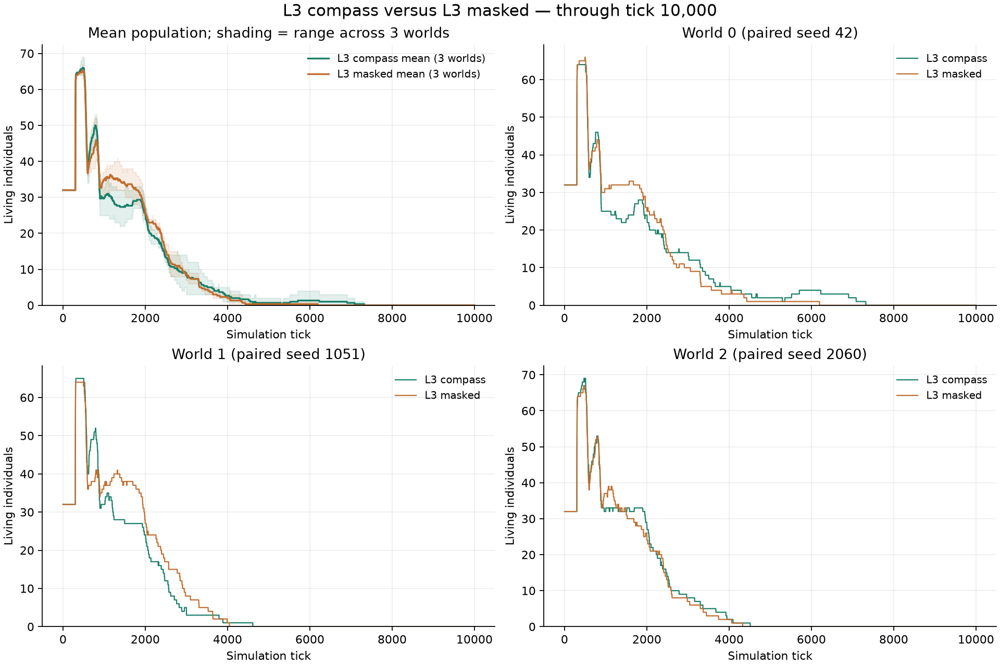
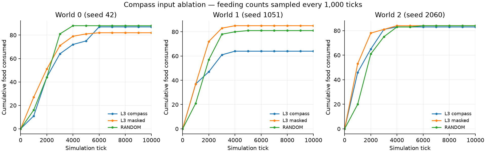

# 絶対方角の入力あり・なし：L3の比較

2026年10月11日。[相対操作と方位入力の設計](../../protocols/compass-input-design.md)。方角あり・同じ入力枠をゼロにした方角なしのL3を各3世界、10,000tickまで実行した。RANDOMも同条件の参考として3世界実行し、全試行が正常に完了した。

## 結果

全9世界で全滅した。

| 条件 | 2,000tick人数：世界0・1・2 | 10,000tick人数：世界0・1・2 | 累計採食数：世界0・1・2 | 全滅tick：世界0・1・2 |
| --- | --- | --- | --- | --- |
| L3 方角あり | 24・24・28 | 0・0・0 | 87・64・83 | 7,323・4,614・4,514 |
| L3 方角なし（ゼロ入力） | 25・27・26 | 0・0・0 | 82・85・84 | 6,198・4,046・4,329 |
| RANDOM（参考） | 18・23・21 | 0・0・0 | 88・81・84 | 5,241・5,517・5,763 |

方角あり・なしの2,000tickまでの採食合計はそれぞれ156回・201回、全期間では234回・251回だった。[数値JSON](data/compass-experiment-results.json)には時点別人数、出生死亡、世代、判断数あたりの採食数も含めた。

今回の3世界では、方角ありの全滅時刻が方角なしよりそれぞれ1,125・568・185tick遅かった。一方、累計採食合計は方角あり234回・方角なし251回で、採食量の改善は一貫していない。全滅の遅れだけを方角を活用した学習の成立とは扱わない。

採食グラフは1,000tickごとの累計記録を結んだもの。単独の方角入力の有無を比較した小規模な結果であり、学習できた方角の意味・長期追跡能力や生涯学習の因果的寄与を確定するものではない。入力は初期のニューラル方策や世代間選抜にも作用し得る。L0との除去比較はまだ行っていない。

## 揃えた条件と確認

縦96×横32、左側25%での初期配置と全出生、右側25%への均一な食料、半径5の視野、相対的な待機・前進・左右90度旋回、基礎代謝0.016、再生率0.00001を使用した。初期32体・容量128、シード42・1051・2060。視野拡大とランドマークは追加していない。

両L3の相違は `compass` 設定だけで、どちらも65,625パラメータ。CPUで生成した学習履歴のないtick 0の同一重み・遺伝基底・個体状態・optimizer状態を各条件へコピーし、V620の2枚で実行した。初期の全学習状態のハッシュが一致し、観測・optimizerの履歴はゼロ。個体間で活動中の重み・経験を共有する処理はない。

方角は方策・エンコーダの入力としてだけ追加した。予測対象は従来の基礎観測368入力のままで、内的評価の22特徴にも方角は含めない。視界のRGBは身体の正面が上になる従来の形式を維持する。

checkpointでは、方角なしのエンコーダの追加4行が出生時の遺伝基底から変化していないこと、方角ありではその行に学習更新があることを確認した。両条件の方策更新と個体別Adamの回数＝年齢も検証した。全計測点の人数・累計出生・累計死亡は全イベントから復元して一致し、評価器ログの採食フラグ数も世界の採食数と一致した。

RANDOMの全tickの人数と各計測点の食料・採食・エネルギー・出生死亡・全滅時刻は、過去の同条件の3世界と完全一致した。この再実行を新しい独立標本には数えない。

## 保存・観察

- 方角あり：[compass-absolute.yaml](../../../configs/experiments/2026-10-11-compass/compass-absolute.yaml)。方角なし：[compass-masked.yaml](../../../configs/experiments/2026-10-11-compass/compass-masked.yaml)。参考：[compass-random.yaml](../../../configs/experiments/2026-10-11-compass/compass-random.yaml)。
- 初期状態・ハッシュ：`runs/compass-ablation-initial/`。再生成方法は[設計](../../protocols/compass-input-design.md#検証再実行)を参照。
- 各試行のcheckpoint・全出生死亡・6本ずつの事前ランダム選択リプレイ：`runs/compass-absolute-L3-10k/`、`runs/compass-masked-L3-10k/`、`runs/compass-RANDOM-10k/`。
- 全tickのCSV・照合・更新確認：`runs/compass-analysis/`。53件のテストとGPU上の両モードの学習検査が成功。
- 評価器の全生存遷移と世界別解析：[方角あり](data/compass-absolute-evaluator.json)、[方角なし](data/compass-masked-evaluator.json)。方角を報酬成分には使っていない。
- [比較画面](http://192.168.0.66:8765/?compare=1&study=compass-10k-study)：上段はL3方角あり、下段はL3方角なし。人数表は同じゲーム内tick。個体を選ぶ単独表示では「方位入力」を確認できる。
- [方角ありの単独表示・リプレイ](http://192.168.0.66:8765/?run=compass-absolute-L3-10k)、[方角なしの単独表示・リプレイ](http://192.168.0.66:8765/?run=compass-masked-L3-10k)。

過去の入力枠なしL3は65,497パラメータで、初期化も異なるため、今回の主対照の代用にはしない。資源供給から基礎代謝だけで換算した維持人数の上限は約3.63体で、台本採食・繁殖方策による長期維持の検査は未実施。

Chromiumで新比較の条件名・完了表示・同tick表、両条件のリプレイと局所視覚、実際の方位入力表示、モバイル幅、従来のL3対RANDOM比較を確認した。JavaScriptエラーなし。観察の検証は `runs/compass-analysis/browser/`。
