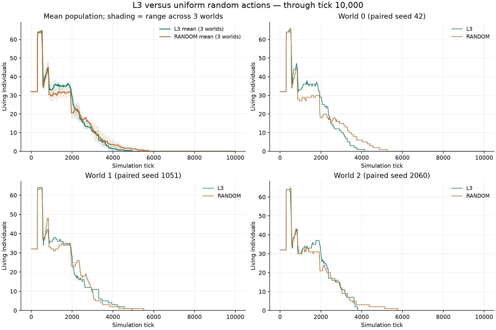
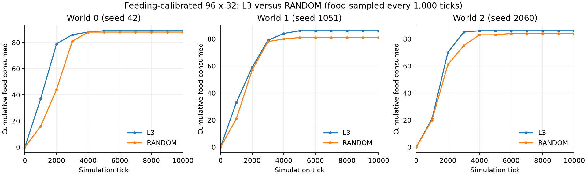
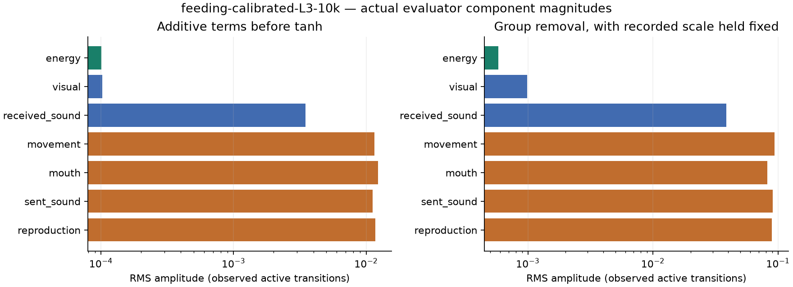

# 採食を較正した96×32でのL3比較

2026年10月11日。[採食を必須にした較正条件](../2026-10-11-random-feeding-calibration/results.md)でL3とRANDOMを各3世界、tick 0から10,000まで実行した。全6世界の実行が正常に完了した。

縦96×横32、左側25%で初期配置と全出生、右側25%に均一な食料、基礎代謝0.016、再生率0.00001。初期32体・容量128、シード42・1051・2060、寿命3,000tick。L3の予測学習と内的評価による更新を有効にし、事前学習・外的な課題報酬・個体間の経験や重み共有は使っていない。

## 結果

両群とも3世界すべてで全滅した。

| 方式 | 2,000tick人数：世界0・1・2 | 10,000tick人数：世界0・1・2 | 累計採食数：世界0・1・2 | 全滅tick：世界0・1・2 |
| --- | --- | --- | --- | --- |
| L3 | 29・28・31 | 0・0・0 | 89・86・86 | 4,138・4,939・3,814 |
| RANDOM | 18・23・21 | 0・0・0 | 88・81・84 | 5,241・5,517・5,763 |

2,000tickまでの採食合計はL3が208回、RANDOMが162回だった。全期間ではL3が261回、RANDOMが253回。今回の3世界では、L3は序盤に多く採食したが全滅は全世界でRANDOMより早く、長期維持の改善にはつながらなかった。

採食数のグラフは1,000tickごとの累計記録を結んだもので、間の各tickの採食時刻を表すものではない。[数値JSON](data/feeding-calibrated-L3-results.json)には時点別人数、2,000tickの採食数、出生・死亡、世代、実際の生存個体の判断数と判断数あたりの採食数も保存した。人数の大小で採食の機会数も変わるため、累計だけを能力の尺度にはしない。

この比較には、学習更新に加えてニューラル方策の初期の偏り・再帰状態とランダム方策の相違も含まれる。各群3シードの結果であり、L3の生涯学習の因果的な寄与をこの比較だけで確定しない。

## 記録と確認

両群の初期世界の全テンソルのハッシュが一致し、実行ソースのハッシュも一致した。設定の相違は `mode` と観察用の評価器記録だけ。RANDOMの全tickの人数、および全計測点の採食・食料・エネルギー・出生・死亡・全滅時刻は、先の30世界での較正の最初の3世界と完全一致した。この再実行は新しい独立標本には数えない。

両群の人数・累計出生・累計死亡を全イベントから照合した。L3では死亡遷移も含めた全生存遷移の評価器成分を保存し、記録中の採食フラグの数が各世界の累計採食数と一致することを確認した。[評価器解析JSON](data/feeding-calibrated-L3-evaluator.json)。

元データは `runs/feeding-calibrated-L3-10k/reward-components/`。tanh前の成分と、他成分・記録した正規化スケールを固定して成分を除いた差を解析する。この振幅を方策への因果的影響とみなさない。

## 設定・観察

- 設定：[feeding-calibrated-L3.yaml](../../../configs/experiments/2026-10-11-feeding-calibrated-l3/feeding-calibrated-L3.yaml)。RANDOMには `--mode RANDOM --no-log-reward-components` を指定。
- 全tickの人数CSV・照合結果・評価器解析：`runs/feeding-calibrated-analysis/`。
- checkpoint・全出生死亡・6本ずつのランダム選択リプレイ：`runs/feeding-calibrated-{方式}-10k/`。
- [比較画面](http://192.168.0.66:8765/?compare=1&study=feeding-calibrated-10k-study)：上段L3、下段RANDOM、左から世界0・1・2。人数表は同じゲーム内tick。
- [L3単独表示・リプレイ](http://192.168.0.66:8765/?run=feeding-calibrated-L3-10k)、[RANDOM単独表示・リプレイ](http://192.168.0.66:8765/?run=feeding-calibrated-RANDOM-10k)。

潜在的な資源供給から、基礎代謝だけで換算した維持人数の上限は約3.63体。台本どおり採食・繁殖する方策の長期存続はまだ実測していない。今回のL3比較は、実験計画のPhase 1全体の完了を意味しない。

checkpointで予測器・エンコーダ・方策・価値の重みが出生時の遺伝基底から変化し、個体別Adamの更新回数が各個体の年齢と一致することを確認した。比較画面の完了表示・同tickの人数表と、両群で採食を含むリプレイの表示・局所視覚もChromiumで確認し、JavaScriptエラーなし。検証記録は `runs/feeding-calibrated-analysis/learning-check.json` と `browser/`。
