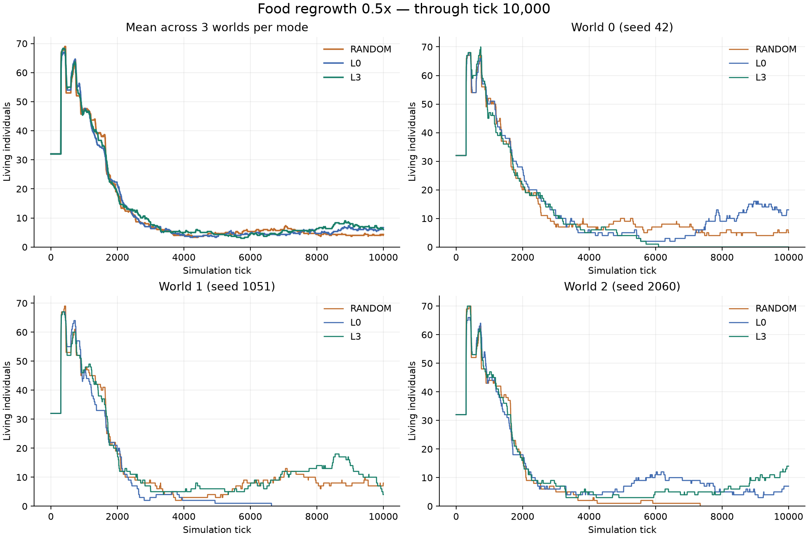

# 食料再生率0.5倍・10,000tickの実験

2026年10月11日。食料再生率だけを0.0001から0.00005へ半減し、RANDOM・L0・L3を各3世界、tick 0から10,000まで実行した。全9世界の試行が正常に完走した。世界シード42・1051・2060、初期32個体、容量128、57×57、固定障害物4%、その他の身体・出生条件は以前と同じ。初期の地形・食料・身体・乱数カウンタの状態ハッシュが元の1倍条件と一致することを確認した。

RANDOMは一様ランダム動作、L0は生涯中の重み更新をしない神経ネットワーク（再帰状態・観測統計・世代間の変異は変わる）、L3は予測学習と内的評価による学習を使う。

## 最終人数

| 方式 | 世界0 | 世界1 | 世界2 | 合計 | 全滅した世界・tick |
| --- | ---: | ---: | ---: | ---: | --- |
| RANDOM | 5 | 8 | 0 | 13 | 世界2・7,342tick |
| L0 | 13 | 0 | 7 | 20 | 世界1・6,635tick |
| L3 | 0 | 4 | 14 | 18 | 世界0・6,089tick |

全方式で3世界中1世界が全滅し、全滅は5,000tick以降だった。残った世界の人数も基準条件より少なくなった。今回の条件では、5,000tick以降にも全滅や再増加があり、定常状態へ入ったと決めつけず推移を残す意味がある。

## 既存の1倍データとの同tick比較

以前の10万tick試行から10,000tick時点を参照した。1倍条件を新たに実行したわけではない。L0は障害物あり・同条件の1倍試行がないため、この表には入れない。

| 方式 | 再生率1倍：世界0・1・2 | 再生率0.5倍：世界0・1・2 |
| --- | --- | --- |
| RANDOM | 19・15・16 | 5・8・0 |
| L3 | 9・13・19 | 0・4・14 |

## 5,001〜10,000tickの平均人数

全滅後の0体も含む。単位は体/世界。

| 方式 | 世界0 | 世界1 | 世界2 | 3世界平均 |
| --- | ---: | ---: | ---: | ---: |
| RANDOM | 5.94 | 8.15 | 0.54 | 4.88 |
| L0 | 7.79 | 0.33 | 7.14 | 5.09 |
| L3 | 0.55 | 10.27 | 6.06 | 5.63 |

## 記録と確認

- 設定：[half-food-10k.yaml](../../../configs/experiments/2026-10-11-half-food/half-food-10k.yaml)。各方式の実設定・ログ・checkpoint・6本ずつのランダム選択リプレイは `runs/half-food-{方式}-10k/`。
- すべての計測時点について、出生・死亡の全イベントから復元した人数と、世界の個体数・累計出生・累計死亡が一致した。自然な全滅と実行障害を分離し、今回は数値異常・実行障害なし。
- [数値JSON](data/half-food-10k-results.json)。全tickのCSVは `runs/half-food-analysis/population.csv`。
- [0.5倍のL3とRANDOMの観察画面](http://192.168.0.66:8765/?compare=1&study=half-food-10k-study)。L0は単独表示で `half-food-L0-10k` を選択する。
- [以前の1倍条件の観察画面](http://192.168.0.66:8765/?compare=1&study=comparison-original-100k)も保存し、別URLから参照できる。
- 観察APIの追加に対する4件のテストが成功。Chromiumで新旧の条件が正しい食料再生率で表示されることを確認した。

各方式3世界の短い試行であり、学習の効果を確定するものではない。ランダム群は2世界で存続している。計画の世界較正には、台本どおり採食・繁殖する検証用方策の確認も引き続き必要になる。
