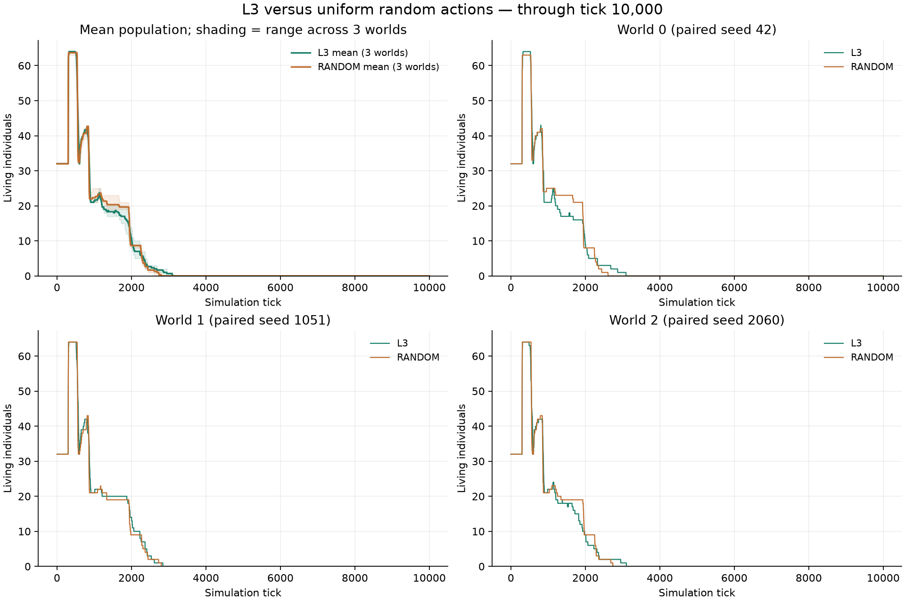
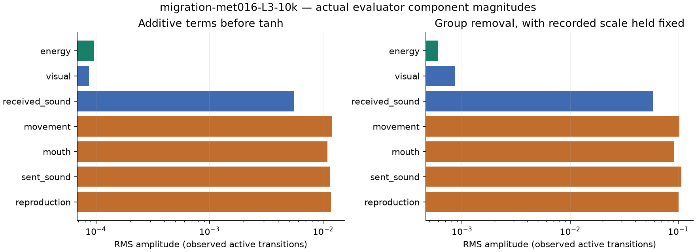

# 基礎代謝0.016：L3と完全ランダムの比較

2026年10月11日。[ランダム群の条件探索](../2026-10-11-random-survival/results.md)で選んだ基礎代謝0.016を使い、L3とRANDOMを各3世界、tick 0から10,000まで実行した。両群とも正常に完走した。

28×112、左側25%での初期配置と全ての出生、右側25%への食料供給、従来の正方形・0.5倍条件と同じ潜在供給期待値を使用した。初期32体・容量128、世界シード42・1051・2060。身体・環境条件は両群で同じで、設定の相違は学習方式と観察用の評価器記録の有無だけ。初期世界の地形・食料・身体・乱数カウンタのハッシュが完全一致し、実行したソースのハッシュも一致した。

L3は従来の予測学習と内的評価による更新を使用する。事前学習・外的な課題報酬・個体間の重みや経験共有は使っていない。RANDOMは各行動成分を各tick独立に一様抽選する。

## 結果

全6世界で全滅した。今回の3シードではL3も個体群を維持できなかった。

| 方式 | 2,000tick人数：世界0・1・2 | 10,000tick人数：世界0・1・2 | 全滅tick：世界0・1・2 | 累計採食数：世界0・1・2 |
| --- | --- | --- | --- | --- |
| L3 | 9・14・9 | 0・0・0 | 3,092・2,843・3,102 | 0・0・0 |
| RANDOM | 8・9・9 | 0・0・0 | 2,608・2,800・2,738 | 0・0・0 |

ランダム群の全tickの人数推移は、先の30世界での探索の最初の3世界と完全一致した。この再実行は同じシードの再現確認であり、新しい独立標本には数えない。人数・累計出生・累計死亡は全出生死亡イベントから復元し、全ての計測点で世界のカウンタと一致した。

各群3シードの比較である。L3とRANDOMの相違にはニューラル方策の初期の偏りや再帰状態も含まれるため、この比較だけで生涯学習の寄与を切り分けることはできない。

## 評価器の記録

L3の全生存遷移（死亡時を含む）について、評価器入力、tanh前の成分、tanh後の内的評価、正規化スケール、採食・移動・出生親・死亡を保存した。記録の定義と解釈は[評価器診断の設計](../2026-10-11-regional-migration/plan.md#評価器の成分別記録)を参照。

[世界別・成分別の解析JSON](data/migration-met016-evaluator.json)。元データは `runs/migration-met016-L3-10k/reward-components/`、解析は `runs/migration-met016-analysis/evaluator/`。

## 設定・保存・観察

- 実行設定：[migration-met016.yaml](../../../configs/experiments/2026-10-11-migration-met016/migration-met016.yaml)。RANDOMには `--mode RANDOM --no-log-reward-components` を指定した。
- [結果の数値JSON](data/migration-met016-results.json)。全tickの個体数CSVと照合結果は `runs/migration-met016-analysis/`。
- 各群のcheckpoint・全出生死亡・6本ずつのランダム選択リプレイは `runs/migration-met016-{方式}-10k/`。
- [比較画面](http://192.168.0.66:8765/?compare=1&study=migration-met016-10k-study)：左列L3、右列RANDOM。各枠は最新画面、人数表は同じゲーム内tick。
- [L3のリプレイを開く](http://192.168.0.66:8765/?run=migration-met016-L3-10k)、[RANDOMのリプレイを開く](http://192.168.0.66:8765/?run=migration-met016-RANDOM-10k)から「リプレイ」を選択する。

比較画面の対象・基礎代謝・寸法・同tick表・リプレイはChromiumと読み取り専用APIで確認する。検証記録は `runs/migration-met016-analysis/browser/`。

## 採食ゼロで全滅時刻が異なった理由

最後まで残った個体の出生と死亡を全イベントから追跡した。世界0・2ではL3だけが第4世代に達し、最後の個体の出生がランダム群より遅かった。世界1ではL3の最後の個体は早く生まれているが、出生後に長く生存した。

| 世界 | 最後の個体の出生tick：L3 / RANDOM | 同個体の寿命tick：L3 / RANDOM | 全滅時刻の差：L3 − RANDOM |
| --- | --- | --- | ---: |
| 0 | 1,561 / 954 | 1,531 / 1,654 | +484 |
| 1 | 1,014 / 1,172 | 1,829 / 1,628 | +43 |
| 2 | 1,545 / 1,099 | 1,557 / 1,639 | +364 |

世界0の差484tickは、出生が607tick遅いことと、出生後の寿命が123tick短いことの合計。世界2も同じ構図だった。世界1の最後の個体はL3で移動成功が75回。両群の最後の個体は全て子として体力30で生まれ、自身は繁殖せず、採食もなく、体力切れで死亡した。基礎代謝が同じなので、出生後の寿命の違いは移動による消耗で説明できる。

ランダム群を元のシード・規則で全滅時点まで再生し、clock以外の全世界テンソルが元の10,000tick checkpointと一致することを確認した。全生存遷移中の移動成功率は、世界0〜2でL3が20.85%・18.06%・22.00%、RANDOMが21.97%・21.71%・21.22%。全世界でL3の移動が少なかったわけではない。

出生では、クローンなら親から40、二親なら各親から20を引き、子に30を渡す。集団の総エネルギーは出生1回につき10減る。採食がなくても、資源を子へ渡す時期・二親間の分配・移動消耗が違えば、最後の死亡時刻は変わる。これだけで採食能力や生涯学習の効果を判定しない。

[個体ID・親子関係・出生死亡・移動の解析JSON](data/migration-met016-reproduction-diagnosis.json)。
