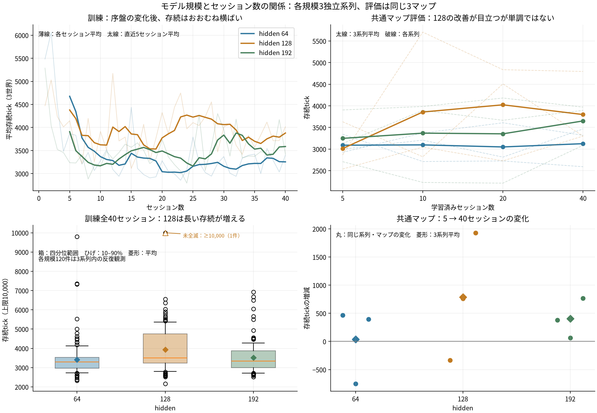

# セッション数・hiddenと存続tickの関係

2026年10月11日。3規模すべてで40セッションと5・10・20・40時点の共通マップ評価が完了した。実行プロセスは正常終了済み。

**モデル規模やセッション数を増やせば一律に存続が延びる、という関係は見られない。hidden 128には存続が延びる傾向があり、192にも共通マップ上で小さい改善があるが、64はほぼ横ばい。128が192より良い場面が多く、単調なサイズ依存ではない。** 各規模3系列の探索的な結果で、最適サイズや一般的な有意差は確定しない。

## 対象・検証・尺度

訓練は3規模×40セッション×3世界＝360世界セッション。共通マップ評価は3規模×4時点×3世界＝36世界セッション。すべて完了分を使用し、132試行のsummary・metadataとmanifestの整合、演算精度FP32、compiled実行、パラメータ数、同一のsource hash、物理的初期状態のdigestを照合した。予測誤差の診断に欠落はなかった。

存続tickは、その世界の最後の個体が死ぬまでの経過時間。個体の平均寿命ではない。10,000tickまで生きた世界は`min(真の全滅時刻, 10000)`として集計する。訓練のhidden 128・第12セッション・World 2だけが1体存続し、真の全滅時刻は不明。これを10,000tickで死んだとは扱わない。共通マップ評価36件はすべて全滅しており、打ち切りはない。

各規模の同じ系列のセッションは、重み・選抜・変異を通じて依存する。評価も同じ3マップを繰り返す。したがって360件・36件を独立標本としてp値を出さない。セッション数とのSpearman相関は**系列ごとに求めたρを3系列で平均した記述値**を主に掲載する。hiddenとの相関は各データ集合をまとめた記述値で、同じマップ・番号での対応差も併記する。

## セッション数との関係

訓練マップはセッションごとに変わるため、同じ別マップで比較した以下の評価を重視する。数値は3系列の平均存続tick。

| hidden | 5セッション | 10 | 20 | 40 | 5 → 40の変化 |
| --- | ---: | ---: | ---: | ---: | ---: |
| 64 | 3,090 | 3,097 | 3,049 | 3,125 | +36（+1.2%） |
| 128 | 3,012 | 3,857 | 4,024 | 3,799 | +787（+26.1%） |
| 192 | 3,248 | 3,369 | 3,353 | 3,651 | +403（+12.4%） |

64はほぼ変化なし。128は5→10→20で伸びたが40では少し下がり、継続するほど一定に改善する形ではない。192は平均の改善量が128より小さいが、5→40の差は3系列すべてで正だった。

| hidden | 訓練1〜40：系列内ρの平均 | 訓練6〜40：系列内ρの平均 | 共通マップ4時点：系列内ρの平均 |
| --- | ---: | ---: | ---: |
| 64 | −0.20 | +0.09 | 0.00 |
| 128 | +0.04 | +0.22 | +0.33 |
| 192 | −0.01 | +0.13 | +0.47 |

訓練全体では、セッション数との単調な正相関はほぼない。序盤に存続が短くなる変化があり、その後は128・192に弱い上昇傾向がある。6〜40の切り分けは序盤とその後を説明するための補助分析で、事前に決めた検定ではない。

共通マップの相関係数は各系列4点だけから求めており、大きさを精密な推定と解釈しない。特に128の5→40の変化はWorld 0〜2で**−332、+762、+1,930tick**。平均の改善にはWorld 2の寄与が大きい。192は**+378、+65、+766tick**、64は**+466、−752、+393tick**だった。

## hiddenとの関係

hiddenと存続tickのまとめたSpearman相関は、訓練360件で**ρ=+0.078**、共通マップ36件で**ρ=+0.210**。Pearson相関はそれぞれ+0.044、+0.170。大きいhiddenほど長く生きる、という単調な関係は弱い。

| hidden | パラメータ数 | 訓練全40の平均存続tick | 中央値 | 5,000tick以上の世界セッション |
| --- | ---: | ---: | ---: | ---: |
| 64 | 65,625 | 3,415 | 3,301 | 5 / 120 |
| 128 | 146,009 | 3,938 | 3,502 | 24 / 120 |
| 192 | 259,161 | 3,522 | 3,336 | 6 / 120 |

128は64に対して平均で+523tick（約15.3%）、中央値では+201tick（約6.1%）。長く続く例が増えたことが平均の差へ大きく寄与している。192は64に対して平均+108tick（約3.2%）で、128からさらに規模を増やした利益は見えていない。

同じセッション番号・世界の対応差でも、128−64は平均+523tick。ただし40セッションを各系列内で平均するとWorld 0〜2で**+683、−103、+991tick**で、全系列が改善したわけではない。192−128の対応差は平均−416tickで、系列別では**−1,012、+886、−1,122tick**。モデルの順位は系列によって変わる。

共通マップの40セッション時点では、64の3,125tickに対して128は3,799、192は3,651。ここでも128が平均では最長だが、128と192の差は148tickにとどまり、3系列の範囲で128が最適だとは言えない。

## 学習の変化と存続を分ける

共通マップ評価の予測誤差は5→40セッションで、64が約20%、128が約52%、192が約50%低下した。規模の大きいモデルでは予測の改善が続いている一方、存続は同じ割合で伸びていない。予測誤差は床が多い画像などの平均を含み、採食や長期維持の理解そのものを測る指標ではない。

128では共通マップの総採食平均が71.7→63.0回に減る一方、存続は+26%だった。World 2は採食70→39回、存続2,865→4,795tick、出生57→38体。採食の増加だけで存続の改善を説明するデータではない。繁殖・活動・個体数によって資源の消費ペースが変わった可能性があるが、その因果はこの相関分析では分離していない。

共通マップでは全36件が5,705tick以内に全滅し、最後7,001〜10,000tickの採食は全件0。訓練の一度だけの10,000tick存続例も最終1,000tickの採食が0だった。**安定した長期維持の基準は全規模で未達。**

## 解釈できる範囲

- セッション数は学習の継続に加え、選抜・変異・継承の回数を増やす。学習だけの因果効果とは分けられていない。生存個体数・実際の経験数・計算量も同じではない。
- 評価はセッション5以降で、未学習のセッション0を同じ評価マップで測ってはいない。今回の増減は5→40の追加経験の変化。
- hiddenの変更はGRU・特徴・後段の容量を変えるが、入力エンコーダは32幅、行動学習が直接更新する範囲などは現行のまま。モデル全体を任意に拡大した実験ではない。
- 64・128は同型の別V620、192はR9700を使った。FP32でも演算経路の違いは残る。192との差をすべてモデル規模の因果効果としない。
- 各規模3系列・評価3マップでは、順位の一般化や細かな最適値の断定には足りない。現時点では「128は改善候補」「4倍にすればさらに伸びる傾向はない」「セッション追加だけで安定維持には至らない」が妥当な読み方。

薄線・破線は単一の世界またはセッションの変動を示し、信頼区間ではない。右下は同じ系列・マップでの5→40の差。左下の1件の10,000tickは打ち切りとして示している。

[機械可読の分析](data/model-session-scaling-relations.json)、[世界・セッション別CSV](../../../runs/scale40-20261011-relations/world-sessions.csv)、[入力manifestの保存](../../../runs/scale40-20261011-relations/inputs)。再計算は`python3 scripts/analyze_scaling_relations.py`。元の訓練・評価・選抜結果は変更していない。

## 2026年10月12日の追加解釈：容量の飽和なのか

試行不足と、容量以外の律速を両方残す。現時点で「hidden 128で表現容量が飽和した」と結論する根拠はない。

40セッション時点の共通マップ評価で、192−128の差は系列別に−213、+669、−899tick、平均−148tick。1系列ずつ除いた2系列の平均差は−115、−556、+228tickで、除く系列によって順位が逆転する。これは記述的な感度分析で、有意差検定ではない。40セッションの反復は3つの独立な学習系列を40個へ増やすものではない。少数試行のRLで平均だけの順位が不安定になり得ることは[Agarwalらの評価研究](https://papers.nips.cc/paper/2021/hash/f514cec81cb148559cf475e7426eed5e-Abstract.html)も扱っている。

以下の実装上の事実がある。ただし、今回の非単調性の原因だと確認する比較実験はまだ行っていない。

| 原因候補 | 確認できたこと | 現時点の判断 |
| --- | --- | --- |
| 初期個体・地図・選抜のばらつき | 各規模3系列、評価は各系列に対応する3マップ。128と192の順位は系列で変わる | はっきり残る不確実性。系列数と評価地図の両方を増やす必要がある |
| 入力表現の制約 | エンコーダは全規模で32幅のまま | ここが律速ならGRUだけ広げても利益が小さい。ただし32幅が不足だとは未確認 |
| 行動に役立つ記憶の学習経路 | 内的評価による更新はactor/criticヘッドだけ。エンコーダ・GRUは感覚予測で学習。BPTTは1 | 増えた記憶容量を、行動に必要な長い依存へ適応させる経路に制約がある |
| 過去の行動への学習信号 | 適格度トレースの直接の重みは約3判断で半減。hiddenを増やしてもγ・λは同じ | 記憶の長さの上限ではない。価値のbootstrapで長い結果も伝えられるが、学習の到達速度は容量だけで解決しない可能性 |
| 更新予算・学習率・最適化 | 1遷移1更新、同じ初期率・勾配制御。生存個体数と個体の経験量は同じではない | 大きいモデルが同じセッション数で同じ到達度まで育ったとは限らない。実更新量等の診断は未実施 |
| 内的評価・選抜・生態 | 感覚予測や内的評価の改善は、食料消費・繁殖・最後の個体の存続と同じ指標ではない | 能力が上がっても存続に変換されない可能性。資源収支や選抜による内的評価の形成が律速かは未確認 |

また、L3の`feat_w`と`feat_b`は生涯中の更新対象ではなく、遺伝・変異・セッション継承で変わる。hiddenを増やした総パラメータすべてが、行動学習によって調整されるわけではない。

40セッション時点の予測誤差は64が0.00795、128が0.00433、192が0.00530。192が128より良くないことは、学習到達度の違いとも整合するが、これだけで学習不足を証明できない。各モデルは自分の行動で異なる観測列を得るため、同じ初期マップでも予測対象の難しさは揃っていない。容量や学習到達度を比較するには、評価だけに使う共通の観測・操作列での予測誤差も必要。一方、5→40で128・192とも予測誤差の数値は約半分になっており、存続の頭打ちを「学習全体が止まった」とは解釈しない。

モデル規模と経験量の組合せで適切な規模が変わり、RLの生の成績が滑らかに変化するとは限らないことは[Hiltonらのスケーリング研究](https://arxiv.org/abs/2301.13442)でも論点となっている。原研究は今回の人工生命・独自L3の飽和を実証するものではない。

切り分けの順序としては、まず保存済みモデルの**系列と地図を交差させた評価**が安価。現在はWorld 0の系列は評価マップ0、系列1はマップ1、系列2はマップ2を使うため、系列差と地図への適性が混ざる。各系列を同じ複数の地図で測れば地図依存を確認できる。ただし評価を増やしても独立した学習系列が増えるわけではなく、初期個体や選抜のばらつきには別seedでの訓練系列追加が必要。

その後、hiddenを固定して入力幅、行動勾配が届く範囲、時間方向の学習経路、更新予算を一つずつ比較する方が、さらにhiddenだけを増やすより原因を切り分けやすい。これは次の比較案であり、追加実験はまだ開始していない。
