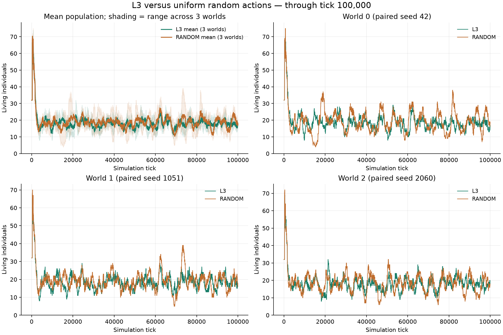

# 学習群と完全ランダム群の10万tick比較

2026年10月11日。障害物ありの既存L3・3世界を保存状態から続け、同じ初期環境・世界シードのRANDOM・3世界を追加した。両群ともゲーム内100,000tickまで完走し、6世界とも全滅しなかった。

## 最終人数と後半の平均

初期人数は各世界32体。直近1万tickは90,001〜100,000tick。平均は出生・死亡の全イベントから各tickの人数を復元して求めた。

| 世界（シード） | L3 最終人数 | RANDOM 最終人数 | L3 直近1万tick平均 | RANDOM 直近1万tick平均 |
| --- | ---: | ---: | ---: | ---: |
| 0（42） | 17 | 18 | 17.98 | 19.88 |
| 1（1051） | 17 | 16 | 18.82 | 18.76 |
| 2（2060） | 18 | 18 | 17.41 | 17.69 |

最終人数は両群とも合計52体。直近1万tickの3世界平均はL3 18.07体/世界、RANDOM 18.78体/世界だった。初期の増加後、両群とも主に十数〜二十数体で増減した。ランダム動作でも集団の存続は成立しており、この試行の個体数だけでL3の優位を示す結果にはなっていない。

## 時点ごとの人数

| tick | L3（世界0・1・2） | RANDOM（世界0・1・2） |
| ---: | --- | --- |
| 0 | 32・32・32 | 32・32・32 |
| 1,800 | 36・32・28 | 33・32・26 |
| 10,000 | 9・13・19 | 19・15・16 |
| 20,000 | 14・21・11 | 24・22・18 |
| 40,000 | 19・20・14 | 22・17・11 |
| 60,000 | 11・16・19 | 12・12・24 |
| 80,000 | 16・14・17 | 10・21・23 |
| 100,000 | 17・17・18 | 18・16・18 |

## 記録の整合と条件

- 世界シード42・1051・2060、57×57、内部障害物4%、各初期32・容量128、寿命3,000tick。他の物理・出生条件も両群で同一。
- L3は独立した神経ネットワーク・生涯学習・遺伝を使用。RANDOMは各操作成分を毎tick独立・一様に選び、重み・学習・遺伝で変わる行動確率を持たない。固定ネットワークL0とも異なる。
- L3は `obstacles-demo-20261011` の1,800tickから `obstacles-100k` に継続。RANDOMは同じ初期条件のtick 0から `random-control-100k` を実行した。再開で新規の独立標本とは数えない。
- 両群の処理速度は違うため、比較には同じゲーム内tickを使った。出生・死亡イベントから復元した人数が、全ての計測時点と累計出生・死亡数に一致した。
- 自動補充・リスポーンなし。全滅なし。容量128への到達や容量不足による出生の拒否も両群で0だった。
- L3の継続部分は約35分39秒（初回1,800tickの約45秒を別途含む）。RANDOMは約9分10秒。GPUと処理内容が異なるため、速度の方式比較を目的とした測定ではない。

## 初期と最後の区間

| 群・世界 | 全期間の最大人数 | 最大に達したtick | 最後1万tickの人数範囲 | 全期間の複製出生 / 二親出生 |
| --- | ---: | ---: | --- | --- |
| L3 / 0 | 74 | 705 | 13〜22 | 1136 / 80 |
| L3 / 1 | 67 | 389 | 15〜27 | 1134 / 172 |
| L3 / 2 | 69 | 420 | 12〜23 | 1105 / 194 |
| RANDOM / 0 | 75 | 723 | 7〜29 | 1120 / 181 |
| RANDOM / 1 | 70 | 409 | 10〜26 | 1118 / 196 |
| RANDOM / 2 | 72 | 387 | 9〜28 | 1079 / 237 |

この結果は一つの環境条件・各3世界の観察であり、学習だけの寄与を分離する実験ではない。L3とRANDOMの個体数が近いことから、行動・記憶・通信等の能力まで同じとは判断しない。

## 再確認

- [6世界の観察画面](http://192.168.0.66:8765/?compare=1&study=comparison-original-100k)：上段L3、下段RANDOM。両群とも完走済み。各実験を選ぶと保存リプレイを再生できる。
- [対照条件と実行手順](plan.md)。35件のテストが成功し、Chromiumで6世界表示・同tickの表・切替・モバイル表示を検査した。
- [比較の数値JSON](data/population-comparison-100k.json)。全tickのCSVは `runs/population-comparison/comparison.csv`。
- 原データ・設定・checkpoint・ランダム選択リプレイは各試行ディレクトリに保存。両群とも観察区間12本ずつを保存した。

再集計：`python3 scripts/compare_population.py`。
