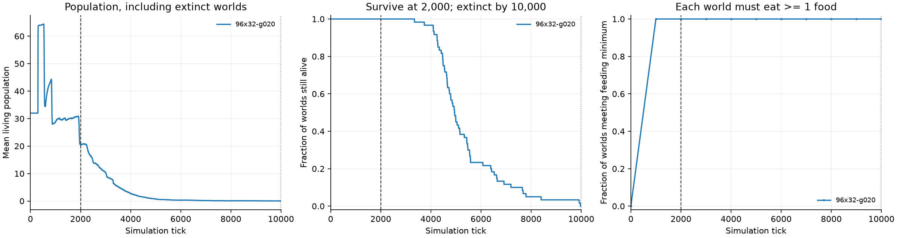

# 採食を必須にしたランダム群の環境較正

2026年10月11日。以前の選択は存続・全滅時刻だけを見ており、選択した60世界中58世界が採食0回だった。採食経験を得られない条件をL3比較の基準にしていたため、採食を必須にして探し直した。

## 現在の候補

| 項目 | 値 |
| --- | --- |
| マップ（縦×横） | **96×32**。長方形で、縦横比は固定しない |
| 面積 | 3,072タイル（以前の28×112の約98%） |
| 初期配置と全ての出生 | 左側25%。子は親の位置に関係なく左側へ現れる |
| 食料の初期配置と再生 | 右側25%の通行可能な床で均一分布 |
| 食料再生率 | **0.00001**（直近の0.00005の1/5） |
| 基礎代謝・移動追加費用 | 0.016/tick・移動成功時0.01 |
| 初期食料係数・1個のエネルギー | 0.12・10 |
| 個体数 | 初期32、容量128 |
| 事前学習・外的な課題報酬 | なし |
| 判定 | 各世界が採食1回以上、2,000tickで存続、10,000tickまでに全滅 |

全世界の平均だけで選ばず、採食0回の世界も含めて判定する。採食回数は管理側の環境較正にだけ使い、AIの報酬には加えない。方策は各行動成分を各tick独立に一様抽選するRANDOM。

## 結果

調整に使った90世界と、未使用シードでの最終確認60世界の**計150世界すべて**が3条件を満たした。

| 集合 | 世界数 | 採食0回 | 世界ごとの累計採食数 | 3条件を満たした世界 |
| --- | ---: | ---: | --- | ---: |
| screen | 30 | 0 | 34〜96 | 30/30 |
| development | 60 | 0 | 42〜100 | 60/60 |
| confirmation | 60 | 0 | 29〜120 | 60/60 |

全体の採食数は1世界あたり29〜120回、中央値71回。2,000tickまでに採食したのは150/150世界。2,000tickでの生存人数は10〜28体、中央値21体。全滅時刻は3,344〜9,968tickだった。これは世界単位の回数であり、全ての個体が採食したという意味ではない。

最終確認は `4,000,042 + 1009 × i`（i=0〜59）。設定は確認前に固定した。以前の確認結果を見て調整したシードは調整用とし、未使用の確認集合と区別した。都合のよいシードや成功世界だけを残していない。

## 探索で分かったこと

1. 1:4を保って11×44まで縮めると採食は増えたが、斑状分布では別シードに採食0回が残った。
2. 均一分布の9×36は別の150世界で採食と短期存続・長期全滅を満たした。縮小案は `configs/experiments/2026-10-11-random-feeding-calibration/random-feeding-small-rectangle.yaml` と [結果JSON](data/random-feeding-small-rectangle-results.json) に保存した。
3. 縦横比を自由にして元に近い面積を保つ128×24・96×32・64×48を試すと、初回30世界では全て採食した。直近と同じ再生率ではランダムでも存続する世界が残った。
4. 96×32で再生率1/4は初回30世界で通ったが、別60世界の1世界が10,000tickでも存続した。再生率1/5を選び直し、使った90シードと新しい60シードで確認した。

失敗した条件も [探索記録JSON](data/random-feeding-search-record.json) と `runs/random-feeding-analysis/` に保存した。どの計測点でも出生・死亡イベントから復元した人数・出生累計・死亡累計が世界の統計と一致した。自然な全滅と実行障害を区別した。確認用設定の指数表記が文字列になった開始前の失敗は、正常な試行数に含めていない。

## 範囲と次の確認

食料の潜在供給は、57×57・同じuniform条件の `Σfertility` を基準に右側へ集約する。初期食料の期待値は69.696個、再生期待値は0.005808個/tick。再生率の変更で潜在エネルギー供給は0.05808/tickとなる。基礎代謝だけで割った維持人数の上限は約3.63体で、移動・出生の費用もかかる。今回はランダム群が採食経験を得る入口の較正であり、多数個体を長期維持する世界の較正は別に確認する必要がある。

台本どおり採食・繁殖する方策での存続は、今回まだ実測していない。実験計画のPhase 1全体を完了したとは扱わない。その後、[この条件でのL3とRANDOMの比較](../2026-10-11-feeding-calibrated-l3/results.md)を実行した。

## 保存と再実行

- 再利用用：[random-feeding-window.yaml](../../../configs/experiments/2026-10-11-random-feeding-calibration/random-feeding-window.yaml)。RANDOM・3世界、シード42・1051・2060。
- [結果JSON](data/random-feeding-calibration-results.json)、最終確認の全tickのCSV・全出生死亡・checkpoint・ランダム選択リプレイは `runs/random-feeding-96x32-g020-confirmation/` と `runs/random-feeding-analysis/final-confirmation/`。
- [ゲーム画面](http://192.168.0.66:8765/?run=random-feeding-96x32-g020-screen)。終了後の動きは「リプレイ」で確認する。
- 探索スクリプトは採食を既定の必須条件にし、合格候補がなければ `selected: null` とする。再解析は `python3 scripts/analyze_random_survival.py`。

Chromiumで96×32のライブ・リプレイ・局所視覚を確認し、JavaScriptエラーなし。事前選択済みリプレイの `random-004`（401tick開始）には7回の食料消失があり、実際の採食を画面で確認できる。説明用に採食のある区間を選んだ例で、較正の統計には全世界を使っている。検証記録は `runs/random-feeding-analysis/browser/`。
