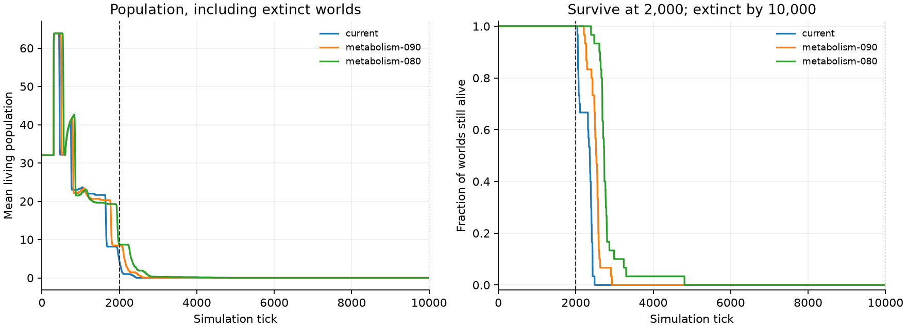

# ランダム群の短期存続・長期全滅条件を探す

この記録は生存期間だけを使った過去の探索で、採食を必須にしていない。[採食を含めて選び直した現在の条件](../2026-10-11-random-feeding-calibration/results.md)を参照。

2026年10月11日。判定条件は、**2,000tickで個体群が1体以上存続し、10,000tickまでに全滅**すること。各個体の無死亡や初期32体の維持を意味しない。ランダム群だけを使用し、事前学習・報酬・固定ネットワークを使わず、4つの行動成分を各tick独立に一様抽選する。

## 条件の比較

[横長条件](../2026-10-11-regional-migration/plan.md)の28×112、左側25%での初期配置と遠隔出生、右側25%での食料供給、供給期待値の維持を固定した。基礎代謝だけを0.020・0.018・0.016に変え、同じ30シードを各条件で10,000tickまで回した。移動成功時の追加コスト0.010、初期体力50、子の体力30、寿命3,000、成熟300tick、出生の総コスト40は固定した。

| 基礎代謝/tick | 両条件を満たした世界 | 2,000tickの人数中央値 | 同人数の範囲 | 全滅tickの範囲 |
| --- | ---: | ---: | --- | --- |
| 0.020 | 30/30 | 4 | 2〜7 | 2,041〜2,484 |
| 0.018 | 30/30 | 8 | 5〜12 | 2,208〜2,934 |
| 0.016 | 30/30 | 9 | 5〜12 | 2,393〜4,807 |

現行条件も30世界すべてで目標を満たした。ただし最も早い全滅が2,041tickで、2,000tickの直後に消える世界がある。基礎代謝0.016では短期時点の人数に余裕があり、次に比較する候補として選んだ。選択規則は、両条件を満たす割合、短期人数の中央値、現行代謝との差の小ささ、の順で事前に保存した。

探索シードは `42 + 1009 × i`（i=0〜29）。条件間では同じシードを使うため、「90個の独立シード」ではなく、30シード×3条件の比較である。元の3世界の人数推移が、30世界に拡張した現行条件の最初の3世界と全tickで一致することも確認した。

## 別シードでの確認

選択済みの基礎代謝0.016を、`1,000,042 + 1009 × i`（i=0〜29）の新しい30シードで確認した。確認結果による候補の選び直しは行っていない。

別シードでも30/30世界が判定条件を満たした。2,000tick時点の人数中央値は9体、範囲は7〜12体。全滅時刻は2,619〜4,458tickだった。10,000tickまで正常に完走し、全世界で0体。全イベントと統計の照合も成功した。

選択条件の探索30世界と確認30世界を合わせると、観測した60世界すべてで目標を満たした。短期人数の中央値は両試行とも9体、全滅時刻の全体範囲は2,393〜4,807tick。最初の30世界では1世界が28回、確認用では1世界が10回採食した。残り58世界は採食できていない。

次に再利用する3世界の設定を [random-survival-window.yaml](../../../configs/experiments/2026-10-11-random-survival/random-survival-window.yaml) に保存した。元の横長条件の設定はそのまま残している。その後、[L3とRANDOMの3シード比較](../2026-10-11-migration-met016/results.md)を実行した。L0との比較は未実施。

[候補のランダム群の観察画面](http://192.168.0.66:8765/?run=random-survival-metabolism-080-30seeds)。リプレイには401tick・1,290tick・1,882tickからの区間と、全滅後の区間が含まれる。

[探索の数値JSON](data/random-survival-screen-results.json)、[別シード確認の数値JSON](data/random-survival-holdout-results.json)。

## 解釈と保存

世界間のばらつきを含め、今回のシードで条件を満たす範囲を見つける探索である。全ての可能なシードでの保証ではない。世界に食料があってもランダム移動では採食できない場合が多く、消耗の調整は移動・採食を学ぶまでの猶予を変える。この条件で学習による改善が起きるかは、今回のランダムのみの試行では判定しない。

人数・出生・死亡は全イベントから復元し、全計測点と世界の累計を照合した。NaN・実行障害による停止は自然な全滅と区別する。

- 探索設定：`configs/experiments/2026-10-11-random-survival/random-survival-current.yaml`、`random-survival-metabolism-090.yaml`、`random-survival-metabolism-080.yaml`。
- 探索の判定規則・候補・シード：`runs/random-survival-study.json`。
- 探索の全結果・全tickのCSV：`runs/random-survival-analysis/`。
- 確認試行：`configs/experiments/2026-10-11-random-survival/random-survival-holdout.yaml`、`runs/random-survival-holdout-30seeds/`。
- 各試行にはcheckpoint・出生死亡ログ・事前にランダム選択したリプレイも残す。

再解析は `python3 scripts/analyze_random_survival.py`。確認試行は `--study runs/random-survival-holdout-study.json --output runs/random-survival-holdout-analysis` を指定する。
