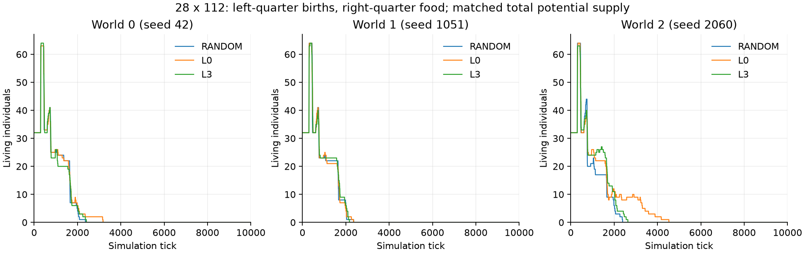
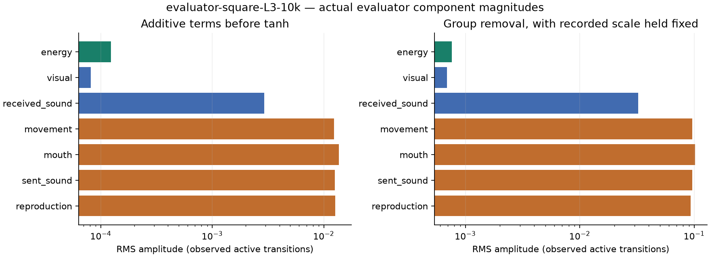

# 横長マップと評価器診断の初回結果

2026年10月11日。[設定・出生・供給量・記録の定義](plan.md)。各条件を10,000tickまで正常に完了した。新しいランダム群の条件探索は別の[生存期間の探索結果](../2026-10-11-random-survival/results.md)にまとめる。

## 横長マップ

同じ3シードで、L3・L0・完全ランダムを実行した。最終時点では全方式・全世界で全滅した。

| 方式 | 2,000tickの人数：世界0・1・2 | 全滅tick：世界0・1・2 | 累計採食数：世界0・1・2 |
| --- | --- | --- | --- |
| RANDOM | 5・7・6 | 2,365・2,359・2,390 | 0・0・0 |
| L0 | 6・5・11 | 3,178・2,357・4,525 | 8・0・45 |
| L3 | 6・6・11 | 2,409・2,165・2,632 | 0・0・16 |

食料の供給期待値は従来と同じだが、ランダム群は一度も食べられなかった。供給場所までの移動と、そこへ着いた後の採食が障壁になる条件である。L0とL3には採食した世界があるが、今回の3シードで学習の優位性は示せていない。出生後の子が左側へ戻り、生涯に獲得した重みを継承しないことも、この条件の難しさに関係し得る。

全計測点の人数・累計出生・累計死亡を、全ての出生死亡イベントから復元して照合した。[数値JSON](data/rectangular-migration-results.json)、`runs/migration-analysis/` のCSV、各 `runs/migration-{方式}-10k/` にcheckpointとランダム選択リプレイを保存した。

## 同じ正方形マップでの評価器診断

従来の0.5倍・L3を最初から再実行し、評価器の実際の成分を記録した。10,000tickで生存数は0・4・14。従来のcheckpointにあった世界・学習器の全109テンソルが、記録を追加した再実行と**完全一致**した。新規の静的な領域マスク2枚だけが追加されている。

全407,086件の生存遷移を解析した。値はtanh前の係数と入力の積。自己エネルギー変化には、採食、代謝、移動、繁殖による増減が含まれる。

| 成分 | RMS | 個体ごとの平均を引いた変動のRMS |
| --- | ---: | ---: |
| 自己エネルギー変化 | 0.0001230 | 0.0001229 |
| RGB平均の変化 | 0.0000816 | 0.0000816 |
| 受信音 | 0.0029204 | 0.0023229 |
| 移動の選択 | 0.0123515 | 0.0099087 |
| 口の選択 | 0.0137105 | 0.0092612 |
| 発信の選択 | 0.0125744 | 0.0110029 |
| 繁殖の選択 | 0.0126545 | 0.0089773 |
| 行動4成分の合計 | 0.0250034 | 0.0196610 |

行動4成分の合計は、自己エネルギー変化に比べ、RMSで約203倍、個体内の変動で約160倍だった。現状の内的評価では、身体の状態変化に比べて行動の選択自体による成分が大きいことが、実際の軌跡でも確認できた。これは評価値の振幅の比較であり、方策への因果的な寄与や学習の良し悪しを直接測った値ではない。

各成分を除いたときのtanh後・記録したスケールによる正規化後の差も計算した。[全世界・世界別の解析JSON](data/evaluator-square-results.json)と、全個体ID付きの元データ `runs/evaluator-square-L3-10k/reward-components/` を参照。横長L3についても `runs/migration-L3-10k/reward-components/` と `runs/migration-analysis/evaluator/` に記録・解析を保存した。

## 検証と観察

既存分を含む43件のテストが成功。長方形の座標・視覚、両繁殖方式での左側出生、エネルギー収支、供給期待値、保存再開、記録の無介入性を検証した。Chromiumで横長のライブ・比較・リプレイ・クリック追跡・モバイル表示と、従来の正方形表示を確認した。JavaScriptエラーなし。検証記録は `runs/migration-analysis/browser/`。

[横長の観察画面](http://192.168.0.66:8765/?compare=1&study=migration-10k-study)は左列L3・右列完全ランダム。L0は実験選択欄から `migration-L0-10k` を選ぶ。[従来の正方形・0.5倍条件](http://192.168.0.66:8765/?compare=1&study=half-food-10k-study)も参照できる。
