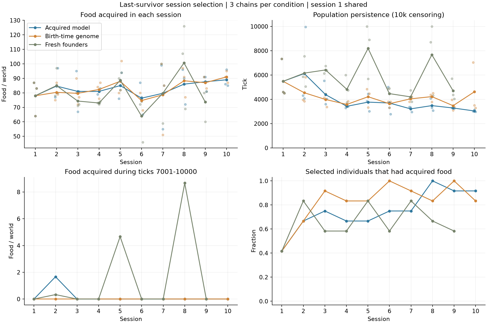
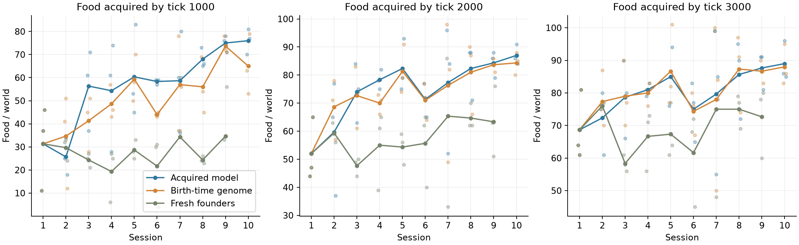

# 最終生存個体の重みを継ぐセッション反復

2026年10月11日。方角ありL3の前回試行を第1セッションとして再利用し、合計10セッションを3条件で比較する。各条件は独立した3世界を持つ。外部データの事前学習と採食・生存への固定報酬は追加しない。

## 選抜と継承

各世界の10,000tick終了時に生存者がいれば、その中から最大4体を観察用の独立乱数で選ぶ。全滅した世界では死亡時刻が最後の4体を使い、同時刻はIDで決める。採食成績は選抜に使わない。世界を混ぜず、選んだ個体を順に8回ずつ複製して次の初期32体を作る。各個体の更新・状態は独立する。3条件ともセッション中は同じL3学習を行う。「毎回未学習」は開始時の重みを戻す条件であり、ランダム行動の条件ではない。

| 条件 | 次の初期個体に渡すもの |
| --- | --- |
| 獲得重み継承 | 最終更新後の全ネットワーク重み・学習率・内的評価係数・観測正規化統計 |
| 出生時重み継承 | 同じ規則で選ばれた個体の出生時の重み・遺伝学習率・遺伝評価係数・出生時の観測正規化統計 |
| 毎回未学習 | 前回比較で使った、同一の未学習創始個体バンク |

獲得重み条件では継いだ重みと観測尺度を新しい遺伝基底として扱う。そのセッション内での出生はこの基底を既存の変異率0.05で継ぐ。生涯中の追加学習・観測統計は世界内の子へ渡さない。通常条件の遺伝基底の観測統計はゼロなので従来動作を保つ。セッション境界で重みを平均したり変異を追加したりしない。

隠れ状態、直前行動、optimizer、トレース、更新上限の履歴、報酬正規化履歴をリセットする。身体も年齢0・体力50に戻す。重みだけを継いで観測尺度を変えてしまうのを避けるため、観測正規化統計はモデルの校正として継承する。この実験は獲得したモデル全体の継承の検査であり、「ニューラル重みだけ」の寄与を分離する検査ではない。

死亡時には旧個体の最終学習を完了してからモデルを退避し、その後で枠を子に再利用する。第1セッションについては選抜IDが最終checkpointに残っていることを検査し、死亡後に凍結された正確な重みを取得した。

## 環境と判定

環境は96×32、左25%に創始個体と子が出現し、右25%にだけ食料を供給する。相対旋回と方角のone-hot入力を維持し、代謝0.016、初期32体、上限128体、寿命3,000tick、既存の内的評価・学習率を使う。各セッションのseedは`42 + (セッション番号-1) × 1,000,003`。3条件には同じマップ・初期位置・体の向きを与え、単一マップへの依存を避ける。世界間seed差は従来どおり1,009。

**安定の事前基準**：同一の世界系列で、10,000tick時点に個体群が存続し、7,001–8,000、8,001–9,000、9,001–10,000tickの各区間で少なくとも1回採食する。これが3セッション連続で成立することを目安とする。合計採食、終盤採食、全滅時刻、選抜個体の採食数も併記し、基準未達でも途中の変化を記録する。

これは10セッションの探索的試行である。基準の達成は無期限の安定性の証明にはならず、未達も長期反復の不可能性の証明にはならない。第1セッションは3条件共通で、以後の観測は独立な30サンプルではなく3つの継承系列である。死亡時刻による選抜には遅く生まれた個体が選ばれやすい性質がある。

全世界の全滅後は、再出現も変動もない区間だけ計算を省略する。論理的な終点・計測区間は10,000tickのまま。無省略の実行と世界・重み・履歴・事前選定リプレイが完全一致するテストを通している。速度値は実際に計算したtickを使う。

## 実行と観察

```bash
.venv/bin/python scripts/run_session_selection.py --prepare-only
ROCR_VISIBLE_DEVICES=0 .venv/bin/python scripts/run_session_selection.py --arm acquired
ROCR_VISIBLE_DEVICES=1 .venv/bin/python scripts/run_session_selection.py --arm genome
ROCR_VISIBLE_DEVICES=2 .venv/bin/python scripts/run_session_selection.py --arm fresh
```

獲得重みと出生時重みの比較は同型のV620を1台ずつ使用し、未学習基準にはR9700を使用する。CPUで作った初期状態をGPUへ読み込む。R9700との差には演算実装の差が混入しうるため、主比較はV620同士である。ゲームは実時間から独立して進み、画面公開はサンプリングする。

比較画面：`http://192.168.0.66:8765/?compare=1&study=session-selection-study`。両条件で開始済みの最新共通セッションを表示する。各リプレイは従来どおり開始前に無作為選択する。

プロトコルは`runs/session-selection-protocol.json`、系列ごとの全結果は`runs/session-selection-{acquired,genome,fresh}.json`。`runs/session-{条件}-s01`が第2セッション、`s09`が第10セッションに当たる。各試行の`elites.pt`には選ばれた個体の獲得モデル・遺伝基底・選抜情報を保存する。

## 結果

2026年10月11日20:19（日本時間）、ユーザーの「一旦区切って現状を整理して」という指示により停止した。学習の計算ジョブは残っておらず、観察用サーバーだけ稼働している。

- 獲得モデル継承：10セッション完了。3系列とも毎回10,000tick前に全滅。
- 出生時モデル継承：10セッション完了。同様に全滅。
- 毎回未学習からL3：9セッション完了。第10セッションは997tickで保存停止。この未完了セッションは成績の平均や安定判定に使わない。停止時の生存数は28・33・31体、採食は14・37・17回。

**序盤の採食には変化があるが、獲得モデルの継承による長期安定は未達。** 3条件がすべて完了した共通の第7〜9セッションを比較する。各値は3世界×3セッションの記述平均であり、9件の独立サンプルとして有意差を主張するものではない。

| 条件 | 最初の1,000tickの採食 | 全期間の採食 | 観測内の存続tick |
| --- | ---: | ---: | ---: |
| 獲得モデルを継承 | 67.2 | 84.4 | 3,329 |
| 出生時モデルを継承 | 62.2 | 84.7 | 3,914 |
| 毎回未学習からL3 | 31.1 | 84.7 | 5,526 |

存続tickは10,000で打ち切った観測値。未学習開始条件の生存世界については真の全滅時刻ではない。採食は個体群全体の回数であり、個体あたりの効率ではない。

両継承条件は同じマップの未学習開始条件より序盤に多く食べるが、合計採食はほぼ同じで、長く存続する方向には変わっていない。獲得モデル継承が出生時モデル継承を一貫して上回るともいえない。

毎回未学習からL3を始めた第8セッションのWorld 1は、10,000tickで4体が生存し、終盤3区間に9・9・8回採食した。採食合計は126回。同じマップの獲得モデル継承は3,308tickで全滅し、採食合計90回、出生時モデル継承は3,789tickで全滅し、採食合計91回だった。これは有限期間の存続例であり、無期限の安定性は確認していない。次の第9セッションでは未学習開始条件も全滅し、事前基準の「3セッション連続」は全条件で未達。

獲得モデルを持ち越す効果は感覚予測誤差に表れた。第8〜10セッションの開始1,000tickの平均予測誤差は、獲得モデル継承約0.0131、出生時モデル継承約0.1632。これには観測校正の継承も含まれる。画像の大部分は床なので、低い予測誤差だけで状況理解や採食の理解が成立したとは判断しない。





## 解釈と残る問い

確認できたのは、モデル・入力校正の継承が機能すること、選抜を繰り返す条件では序盤の採食が増えること、今回の範囲ではその変化が長期の個体群維持につながらないこと。

原因候補は、初期食料を早く消費してしまうこと、食料の再生に対して個体数や繁殖コストが大きいこと、4体への絞り込みによって多様性が失われること、予測や内的評価の改善と長期維持が一致しないこと。いずれもこの実験だけでは原因を分離できていない。死亡時刻の選抜には出生が遅い個体を拾いやすい性質もある。

次に検討するなら、同じ重みで食料残量・個体数・出生・死亡・採食の時系列を重ね、食べ尽くしと繁殖のどちらが存続を制限しているかを診断する。今回の結果だけで報酬を追加する必要性や、獲得モデル継承の一般的な有効・無効を断定しない。追加実験は開始していない。

## 保存・検証

- 継承する重みの一致、状態リセット、同じセッションの物理的初期状態の一致を全27個の新規初期checkpointで確認。
- 完了した26個の新規試行で、選抜IDが「生存者優先、全滅時は最後の死亡4体」の規則と一致。
- 全59件のテストが通過。死亡と出生が同時の枠再利用、私有状態、保存再開、全滅後の計算省略とリプレイの一致を含む。
- [機械可読の結果](data/session-selection-results.json)、[初期状態・選抜の照合](data/session-selection-initialization-audit.json)。詳細の世界別数値は`runs/session-selection-analysis/world-sessions.csv`。
- 未完了の再開用保存先：`runs/session-fresh-s09/checkpoint.pt`（997tick）。`summary.json`は`interrupted`、系列manifestはユーザーの指示による`paused`として記録。人工的な保存停止を全滅や自然死には数えない。

セッションを再開する場合は、このcheckpointを新しい試行ディレクトリへ読み込み、完了後に系列manifestの試行先を更新する必要がある。今回は再開せず保存した。

## セッション別の完了結果

採食は3世界の値を順に表示する。`存続`は全滅時刻を表示し、終了時に生存している場合は`10,000以上`とする。第1セッションは共通の前回試行で、3条件で別々に再実行したものではない。

### 獲得モデルを継承

| セッション | 採食回数 W0 / W1 / W2 | 存続tick W0 / W1 / W2 |
| --- | --- | --- |
| 1 | 87 / 64 / 83 | 7,323 / 4,614 / 4,514 |
| 2 | 77 / 80 / 97 | 4,318 / 4,087 / 9,960 |
| 3 | 95 / 67 / 81 | 5,521 / 3,607 / 4,030 |
| 4 | 79 / 81 / 83 | 3,300 / 3,568 / 3,411 |
| 5 | 76 / 85 / 94 | 3,843 / 4,458 / 3,012 |
| 6 | 87 / 77 / 65 | 5,009 / 3,309 / 2,774 |
| 7 | 99 / 55 / 85 | 3,371 / 3,323 / 2,953 |
| 8 | 96 / 90 / 72 | 4,069 / 3,308 / 3,072 |
| 9 | 91 / 91 / 81 | 3,302 / 3,302 / 3,260 |
| 10 | 86 / 96 / 85 | 3,018 / 3,134 / 2,979 |

### 出生時モデルを継承

| セッション | 採食回数 W0 / W1 / W2 | 存続tick W0 / W1 / W2 |
| --- | --- | --- |
| 1 | 87 / 64 / 83 | 7,323 / 4,614 / 4,514 |
| 2 | 75 / 87 / 79 | 3,957 / 3,834 / 5,832 |
| 3 | 90 / 72 / 77 | 4,133 / 4,457 / 3,372 |
| 4 | 84 / 76 / 87 | 3,499 / 3,405 / 3,838 |
| 5 | 80 / 82 / 102 | 4,843 / 3,334 / 4,468 |
| 6 | 80 / 76 / 68 | 3,802 / 3,307 / 3,812 |
| 7 | 100 / 51 / 85 | 3,797 / 4,111 / 4,216 |
| 8 | 97 / 91 / 77 | 4,376 / 3,789 / 4,507 |
| 9 | 91 / 87 / 83 | 3,958 / 3,102 / 3,371 |
| 10 | 91 / 95 / 87 | 7,046 / 3,511 / 3,300 |

### 毎回未学習からL3

| セッション | 採食回数 W0 / W1 / W2 | 存続tick W0 / W1 / W2 |
| --- | --- | --- |
| 1 | 87 / 64 / 83 | 7,323 / 4,614 / 4,514 |
| 2 | 78 / 97 / 80 | 5,865 / 7,556 / 5,055 |
| 3 | 80 / 71 / 72 | 6,133 / 6,748 / 6,377 |
| 4 | 73 / 72 / 74 | 5,994 / 3,741 / 4,735 |
| 5 | 90 / 82 / 94 | 9,990 / 5,689 / 8,904 |
| 6 | 72 / 74 / 46 | 4,855 / 4,909 / 3,646 |
| 7 | 100 / 59 / 80 | 4,065 / 4,736 / 3,812 |
| 8 | 107 / 126 / 69 | 8,700 / 10,000以上 / 4,316 |
| 9 | 80 / 60 / 81 | 5,704 / 4,366 / 4,035 |


## 追加のエネルギー収支診断（計算再開なし）

ユーザーの移動・繁殖コストについての質問を受け、保存済みの第7〜9セッションのイベントと指標を集計した。学習シミュレーションは再開していない。[集計値と世界別データ](data/session-selection-energy-diagnosis.json)。各値は9世界セッションの記述平均。

| 指標 | 獲得モデル継承 | 毎回未学習からL3 |
| --- | ---: | ---: |
| 1,000tickまでの採食 | 67.2 | 31.1 |
| 全期間の採食 | 84.4 | 84.7 |
| 1,000tick時点の生存数 | 44.3 | 34.1 |
| 1,000tick時点の地面の食料 | 10.8 | 46.6 |
| 1,000tickまでの出生数 | 49.6 | 45.9 |
| 全期間の出生数 | 52.3 | 57.1 |
| 全個体の観測内の生存tick合計 | 94,072 | 100,263 |

増えたのは主に序盤の採食で、総採食量はほぼ同じ。継承条件では早い段階で食料が個体の体力へ移り、生存個体数も多いため、早期の代謝・活動に回る可能性がある。全期間の繁殖数は継承条件の方が少ないので、単純な「出生数が多すぎる」だけでは説明できない。また、全個体の生存tick合計の差は小さく、世界の最後の個体が死ぬ時刻の差とは区別する必要がある。

クローン出生では親から40が引かれ、子に30が移り、集団全体の正味損失は10。有性出生も両親合計40→子30で同じ正味損失となる。さらに子の基礎代謝が増え、子は食料のない左側へ出現するため右へ移動し直す。親の40をすべて消失エネルギーとして計上しない。採食も移動もなければ、初期体力50の親が成熟300tick直後にクローンを作ると体力は約5.2になる。

移動コストは実際に前へ1マス進めたとき0.01。旋回・待機・障害物による移動失敗には追加コストがない。全生存個体には別に毎tick0.016の基礎代謝がある。

1,000tick時点の収支は、初期体力1600＋採食×10－名目基礎代謝－出生の正味損失－生存個体の残存体力を計算すると、獲得モデル継承約212.7、未学習開始約91.6が残る。この時点は寿命3,000tickに達する個体がおらず、残差の主な内訳は移動コストと体力上限100を超えた採食エネルギーの切り捨て。ただし今回の新規試行は成功移動の累計と上限ロスを保存していないため、この2項を分離できない。死亡直前の0への丸めと浮動小数の誤差も小さく含む。残差をそのまま移動消費と呼ばない。

再生される食料の潜在的な供給は1世界あたり約0.05808エネルギー/tick。全マスの食料が空で出現阻害もなく全量を回収できるという上限でも、基礎代謝だけなら平均3.63体分。移動・繁殖・取り逃しを含めるとさらに少ない。初期32体・序盤ピーク平均約69体の維持には、初期食料を使い切った後の人口減少と少数個体への継続的な供給が必要になる。これは供給の期待値の上限であり、常に3.63体が維持できる保証ではない。

現時点では、食料を食べる時期・個体数と繁殖によるエネルギー再配分・移動または満腹時の損失が関与する可能性がある。移動や繁殖それぞれの因果効果は未確定。次の診断では成功移動消費、出生の正味損失、基礎代謝、食料の上限ロス、寿命死時の残存体力を別々に記録すると収支を閉じられる。
