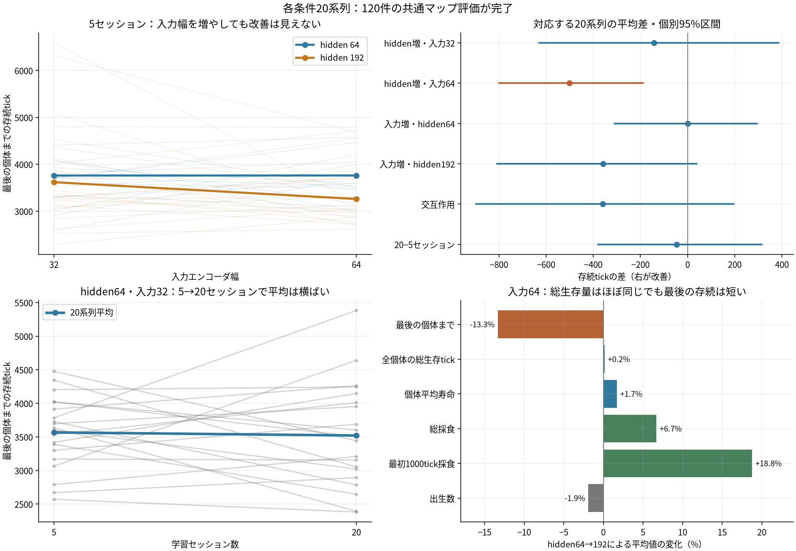

# 各条件20系列：入力幅・hidden・セッション数の結果分析

2026年10月12日。全条件が完了し、3GPUの実行プロセスはすべて正常終了した。訓練800世界セッション、共通マップ評価120世界セッションを分析した。Aは4構成×20系列、Bは別の20系列の5/20時点。条件間・時点間は試行番号を対応づける。

**今回の範囲では、hidden・入力幅・セッション数を増やしたときの明確な存続改善は確認できない。入力幅64ではhidden 192の「最後の個体までの存続」が短かった。ただし全個体の総生存量はほぼ同じで、個体群全体の能力が一様に悪化したとは解釈しない。容量の飽和を立証した実験でもない。**

## 完了状況と監査

120本の訓練実行、18本の評価実行について、完了状態、世界数、hidden・入力幅、GPU割当て、FP32/compiled、パラメータ数、seed、初期物理状態のdigest、同一のsource hashを照合した。指標・summary・manifestは一致し、予測誤差の集計欠落や途中再開はなかった。

全個体の生存tickは出生・死亡イベントから個体ごとの`死亡tick−出生tick`を求めて合計した。各評価実行について、復元した合計が実際の判断回数と一致することも確認した。初期32個体の出生tickは0、新生個体の最初の判断は出生の次tickとする。

主指標の存続tickは、世界の最後の個体が死ぬまでの時間で、平均個体寿命とは異なる。共通マップ評価120件には10,000tick打ち切りはなく、すべて6,590tick以内に全滅した。最後7,001〜10,000tickの採食も全件0。

訓練800件のうち、Bの第1セッション・試行18だけが10,000tickで存続した。終盤採食を伴う存続はその1セッションだけで、最長連続は1。従来の「3セッション連続で終点存続かつ各終盤区間の採食あり」は達成していない。

## 主結果

各行20系列。同じ番号の評価地図を使用する。AとBは異なる初期個体・訓練地図の系列であり、Aの5とBの20を直接比較せず、時間の比較にはB内の対応差を使う。

| 比較 | hidden | 入力幅 | 学習セッション数 | 平均存続tick | 中央値 | 総採食の平均 |
| --- | ---: | ---: | ---: | ---: | ---: | ---: |
| A | 64 | 32 | 5 | 3,760.6 | 3,713.5 | 81.0 |
| A | 64 | 64 | 5 | 3,761.2 | 3,646.5 | 74.0 |
| A | 192 | 32 | 5 | 3,618.2 | 3,300.0 | 78.9 |
| A | 192 | 64 | 5 | 3,259.8 | 3,080.0 | 78.9 |
| B | 64 | 32 | 5 | 3,566.8 | 3,619.5 | 80.1 |
| B | 64 | 32 | 20 | 3,520.8 | 3,474.0 | 72.4 |

入力幅32ではhiddenを192へ増やす利益は確認できない。入力幅64では、hiddenを増やすと平均存続が501tick、約13.3%短くなった。入力幅を32→64へ増やしても、hidden 64で平均はほぼ同じ、hidden 192では平均が短くなる側だった。

hidden 64・入力32の5→20セッションは平均−46tick（−1.3%）。改善した系列と短くなった系列は10対10で、継続するほど一貫して存続が延びる傾向はない。

## 対応差と不確実性

区間は事前に定めた、GPUブロック内で試行番号を再標本化する10,000回のpaired bootstrapによる個別95%区間。各比較は同じ20番号を対応づけ、正の値が改善。6つの区間を同時に95%で覆う多重比較調整済みの区間ではない。

| 比較 | 平均差tick | 個別95%区間 | 差が正の系列 |
| --- | ---: | --- | ---: |
| 入力32でhidden 192−64 | −142.4 | −629.0 〜 +384.8 | 8/20（同値1） |
| 入力64でhidden 192−64 | −501.4 | −798.7 〜 −189.6 | 6/20 |
| hidden 64で入力64−32 | +0.7 | −309.9 〜 +294.7 | 10/20 |
| hidden 192で入力64−32 | −358.4 | −808.3 〜 +37.1 | 10/20 |
| hiddenと入力幅の交互作用 | −359.1 | −897.6 〜 +194.8 | 7/20 |
| Bで20−5セッション | −46.0 | −379.7 〜 +314.4 | 10/20 |

入力64でhiddenを増やす比較が最もはっきり短くなる側だった。GPU別の平均差もV620① −197、V620② −601、R9700 −741tickで、R9700群だけが平均を下げた形ではない。ただし各GPU群も少数の試行なので、この内訳を追加の有意差判定には使わない。

補助分析として、20個の対応差の符号を全`2^20`通り反転し、絶対平均差が観測値以上になる割合を両側p値とした。6つの統計量にHolm補正を適用すると、入力64でのhidden増加だけがp≈0.048（補正前0.0080）、他は0.714以上だった。方法は[対応を保持する符号反転検定](https://docs.scipy.org/doc/scipy/reference/generated/scipy.stats.permutation_test.html)に相当する。

この検定方法は結果を見た後の補助分析で、対応差の符号対称性・交換可能性を仮定する。p≈0.048は境界的な値で、悪化の方向を補強する材料として扱い、一般的な容量限界や因果機序を確定するものとはしない。一次の推定は事前設定した対応差と区間。

入力幅の交互作用の区間は0をまたぐので、「入力を広げたため大きいGRUが特別に悪化した」という機序までは確定できない。改善を検出しなかった比較についても、効果が厳密に0だと証明したわけではない。例えば20−5の区間は、平均で約314tickの改善も約380tickの低下も残す。

## 最後の個体までの存続と、個体群全体の生存量

入力幅64でhidden 64→192を比較すると、次のようになる。個体平均寿命は各世界で平均を求め、その20系列の平均を示す。

| 指標 | hidden 64 | hidden 192 | 平均値の変化 |
| --- | ---: | ---: | ---: |
| 最後の個体までの存続tick | 3,761.2 | 3,259.8 | −13.3% |
| 全個体の総生存tick | 90,196.6 | 90,333.0 | +0.15% |
| 個体平均寿命tick | 1,068.0 | 1,086.3 | +1.7% |
| 総採食 | 74.0 | 78.9 | +6.7% |
| 最初1,000tickまでの採食 | 55.9 | 66.4 | +18.8% |
| 出生数 | 52.9 | 51.9 | −1.9% |

総生存tickの対応差は+136、探索的95%区間は約−3,427〜+3,982tickで、明確な差は見えない。主指標が短くなったことを、全個体が短命になった、採食能力が一様に落ちた、という意味には読み替えない。

最後の個体までの存続は「その個体の出生tick＋その個体の寿命」。観測された平均−501.4tickを分けると、最後まで残った個体の出生が−225.0tick、寿命が−276.4tickだった。この二つの合計が主指標の差になる。これは選ばれた最終個体についての記述的な分解で、出生時期を早めた因果効果を推定したものではない。

存続を最後の個体だけで測ると、遅く生まれた少数の個体や長寿命の外れ値に影響される。最後の死亡個体を次の初期集団に使う選抜にも、出生時期が遅い個体を拾いやすい性質がある。今後は最後の存続に加え、総生存量・年齢分布・終盤採食を並べて評価する必要がある。

## 追加セッションで起きた変化

Bの5→20では、最後の個体までの存続はほぼ横ばいだった一方、総採食は80.1→72.4（−9.6%）、出生数は53.6→49.8、総生存tickは91,638→88,546（−3.4%）になった。個体平均寿命は1,081.5→1,099.0で、こちらはわずかに長い。単純な「繁殖が増えすぎたため存続しない」という平均値の説明とは合わない。

予測誤差の遷移数で重みづけた平均は0.010732→0.008995、約16.2%低下した。各GPUブロックでも約12〜19%の低下があった。予測誤差の数値上の改善は継続しているが、長期維持の改善にはつながっていない。誤差は各モデルが自分の行動で得た観測上の値であり、同じ観測列に対する予測能力を直接比較した値ではない。

## エネルギーから言えること

モデル規模そのものへの体力コストは設定していない。全条件で代謝率0.016、移動費0.01、出生時の親から子へのエネルギー移転30と追加消費10は同じ。総生存tickから代謝の名目消費を、出生数から追加消費を求められる。

入力64のhidden 64→192で、名目代謝消費は1,443.1→1,445.3、出生の追加消費は528.5→518.5だった。どちらも大きな増加ではない。初期体力＋食料エネルギーからこの二つを引いた残差は367.9→425.2。

残差には移動費、寿命切れで残った体力、体力上限で失った採食分、終端時の0へのclampによる差と丸めが混ざる。現在のログから移動費だけを正確に分解できない。より早い採食・資源消費や活動量の変化は候補だが、今回の結果で移動が原因だと断定しない。

## 今回の判断

- 3系列の偶然だけで幅増加の利益を見逃した、という期待を支える結果にはならなかった。20系列でも明確な正の利益は確認できない。
- この環境・学習法・予算では、hidden 64・入力32を軽い基準として使うのが妥当。入力64の追加パラメータに、存続指標上の利益は見えていない。
- ただし容量飽和は未証明。Aは5セッションのみなので、大きいモデルを20以上のセッションで育てた結果は今回測っていない。前回のhidden 128も今回の条件には含まれず、128の良否をこの実験で直接確定できない。
- 入力幅・hiddenを増やしても、行動学習がGRUへ直接届かないこと、予測BPTT長1、割引・適格度トレース、内的評価と選抜の方式は変えていない。これらを原因として確定したわけではないが、さらに幅だけを増やすより、学習経路・時間尺度・選抜指標を切り分ける価値が高い。
- 安定した長期維持は未達。新しい学習実験は開始せず、今回の保存済み結果だけを分析した。

太線・菱形は平均、薄線は対応する系列。右上は個別95%bootstrap区間で多重比較調整済みの区間ではない。右下の割合は平均値の比から求めた記述値で、すべてが有意に変化したという意味ではない。

[機械可読の詳細](data/replicate-width-session-results.json)、[個体寿命を復元した試行別CSV](../../../runs/rep20-20261012-final-analysis/trials-with-lifetimes.csv)、[入力ファイルの保存](../../../runs/rep20-20261012-final-analysis/inputs)。再計算は`python3 scripts/analyze_replicate_results.py`。元の訓練・評価・選抜データは変更していない。
